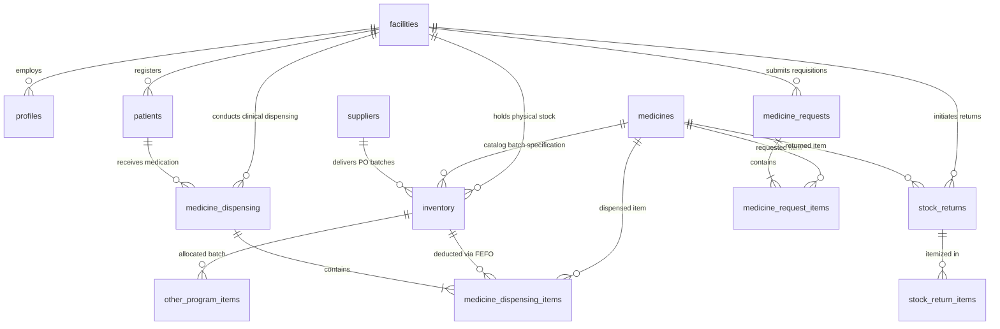

# PRDS Current Supabase Database Setup & Schema Reference

> **System:** Pharmaceutical Resources Distribution System (PRDS) — City Health Office (CHO) of Naga, Cebu  
> **Database Platform:** Supabase Cloud (PostgreSQL 15)  
> **API Layer:** PostgREST API with Row Level Security (RLS)  
> **Local Client Mirror:** SQLite (`prds.db`) via Tauri SQL Plugin (`@tauri-apps/plugin-sql`)  
> **Last Verified & Audited:** October 2026  

---

## 1. Architecture & Platform Overview

PRDS operates as a dual-layer, offline-first clinical and inventory distribution system:

1. **Cloud Backend (Supabase PostgreSQL 15):**
   * Acts as the single source of truth for the City Health Office central warehouse and all 28 Barangay Health Stations.
   * Access is gated through Supabase PostgREST with strict **Row Level Security (RLS)** policies.
   * Authentication integrates Supabase GoTrue Auth with custom role-based profile permissions (`PHARMA_II`, `PHARMA_I`, `CHO`, `BHW`).

2. **Offline-First Native Mirror (SQLite `prds.db`):**
   * Desktop client replicates operational tables to local SQLite storage.
   * Offline mutations (dispensing, stock counts, requests, returns) are queued in `offline_mutation_queue` and synchronized idempotently via `syncManager.js` when network connectivity is established.

3. **Log Quota Optimization (Supabase Free Tier Guard):**
   * Operational monitoring prioritizes zero-cost direct PostgreSQL queries (`pg_stat_activity`, table counts, audit tables) over high-volume ClickHouse analytical log queries (`query_logs`).

---

## 2. Complete Database Table Catalog

### A. Core Master Catalog & Organization

#### 1. `facilities`
Stores the City Health Office central warehouse and all 28 Barangay Health Stations across the City of Naga, Cebu.
* **Primary Key:** `id` (UUID, `gen_random_uuid()`)
* **Columns:**
  * `facility_name` (`text`, NOT NULL) — e.g., `"City Health Office - City of Naga"`, `"Tinaan Health Station"`
  * `facility_code` (`text`, UNIQUE, NOT NULL) — e.g., `"CHO"`, `"BHC-TIN"`
  * `facility_type` (`text`, NOT NULL) — `'CHO'` (Central Hub) or `'BHW'` (Barangay Station)
  * `latitude`, `longitude` (`numeric`, Nullable) — Geographic coordinates for GIS distribution mapping
  * `status` (`text`, DEFAULT `'ACTIVE'`)
  * `created_at`, `updated_at` (`timestamptz`)

#### 2. `medicines`
Defines the standard pharmaceutical formulary catalog approved by the City Health Office. Note that brand names and unit costs are tracked per inventory procurement batch in `inventory`, keeping the master formulary strictly generic and normalized.
* **Primary Key:** `id` (UUID, `gen_random_uuid()`)
* **Columns:**
  * `generic_name` (`text`, NOT NULL) — International nonproprietary name (e.g., `"Amoxicillin"`)
  * `dosage` (`text`, NOT NULL) — Strength and form (e.g., `"500mg"`, `"100 mg/mL, 10 mL"`)
  * `unit_of_measure` (`text`, NOT NULL) — Dispensing packaging (e.g., `"capsule"`, `"tablet"`, `"bottle"`, `"vial"`)
  * `categories` (`text[]` or `jsonb`) — Therapeutic groups (e.g., `["Anti-Infectives", "Analgesics"]`)
  * `created_at`, `updated_at` (`timestamptz`)

#### 3. `suppliers`
Accredited pharmaceutical manufacturers, wholesale distributors, and DOH procurement sources.
* **Primary Key:** `id` (UUID, `gen_random_uuid()`)
* **Columns:**
  * `supplier_name` (`text`, NOT NULL) — Corporate entity name
  * `contact_person`, `contact_number`, `email`, `address` (`text`, Nullable)
  * `status` (`text`, DEFAULT `'ACTIVE'`)
  * `created_at`, `updated_at` (`timestamptz`)

#### 4. `profiles`
User identity profiles linked 1:1 to Supabase `auth.users(id)` with PRDS role credentials.
* **Primary Key:** `id` (UUID, references `auth.users(id)` ON DELETE CASCADE)
* **Columns:**
  * `first_name`, `last_name` (`text`, NOT NULL)
  * `email` (`text`, UNIQUE)
  * `phone_number` (`text`, Nullable) — Linked Philippine phone number
  * `avatar_url` (`text`, Nullable) — Profile avatar asset reference
  * `role` (`text`, NOT NULL, DEFAULT `'BHW'`) — `'PHARMA_II'`, `'PHARMA_I'`, `'CHO'`, `'BHW'`
  * `facility_id` (`uuid`, references `facilities(id)`) — Station custodian assignment
  * `status` (`text`, DEFAULT `'PENDING'`) — `'PENDING'`, `'ACTIVE'`, `'REJECTED'`, `'DEACTIVATED'`
  * `passcode_hash` (`text`, Nullable) — Salted hash for fast desktop workstation unlocking
  * `created_at`, `updated_at` (`timestamptz`)

---

### B. Physical Inventory & Batch Lifecycle

#### 5. `inventory`
Physical stock batches tracked per medicine, lot, and custodian health facility.
* **Primary Key:** `id` (UUID, `gen_random_uuid()`)
* **Columns:**
  * `facility_id` (`uuid`, references `facilities(id)` ON DELETE CASCADE) — Current holding facility
  * `medicine_id` (`uuid`, references `medicines(id)` ON DELETE CASCADE)
  * `supplier_id` (`uuid`, references `suppliers(id)`, Nullable)
  * `brand_name` (`text`, Nullable) — Commercial brand identifier for this specific delivery/lot (e.g., `"Medimox"`)
  * `quantity` (`integer`, NOT NULL, DEFAULT 0, CHECK `quantity >= 0`) — Physical units in stock
  * `threshold` (`integer`, NOT NULL, DEFAULT 0) — Reorder warning threshold
  * `batch_number` (`text`, NOT NULL) — Manufacturer batch/lot code
  * `po_number` (`text`, Nullable) — LGU Purchase Order delivery receipt reference
  * `unit_cost` (`numeric(10,2)`, Nullable) — Specific lot acquisition unit cost (PHP)
  * `date_received` (`date`, NOT NULL) — Date delivered/received
  * `expiration_date` (`date`, NOT NULL) — Expiry date for FEFO sequencing
  * `origin_facility_id` (`uuid`, references `facilities(id)`, Nullable) — Origin if stock was returned
  * `intake_type` (`text`, DEFAULT `'PROCUREMENT'`) — `'PROCUREMENT'` or `'RETURN'`
  * `return_reason` (`text`, Nullable)
  * `status` (`text`, DEFAULT `'ACTIVE'`) — `'ACTIVE'`, `'EXPIRED'`, `'DISPOSED'`
  * `disposed_at` (`timestamptz`, Nullable) — Timestamp when batch was condemned/destroyed
  * `disposal_method` (`text`, Nullable) — Condemnation protocol applied
  * `disposed_by` (`uuid`, references `profiles(id)`, Nullable)
  * `created_at`, `updated_at` (`timestamptz`)

#### 6. `stock_returns`
Ledger of returned or quarantined batches from Barangay health centers to the CHO Central Warehouse.
* **Primary Key:** `id` (UUID, `gen_random_uuid()`)
* **Columns:**
  * `return_id` (`text`, UNIQUE) — Standardized return reference code (e.g., `RET-HCINAYAGAN-20261014-2D3E`)
  * `facility_id` (`uuid`, references `facilities(id)`) — Originating barangay health station
  * `source_inventory_id` (`uuid`, references `inventory(id)`, Nullable) — Source inventory ledger batch deducted
  * `medicine_id` (`uuid`, references `medicines(id)`)
  * `medicine_name` (`text`, NOT NULL), `brand_name` (`text`, Nullable)
  * `lot_no` (`text`, NOT NULL) — Returned batch/lot number
  * `quantity` (`integer`, NOT NULL, CHECK `quantity > 0`)
  * `unit_cost` (`numeric(10,2)`, DEFAULT 0.00)
  * `expiration_date` (`date`, NOT NULL)
  * `reason` (`text`, NOT NULL) — Reason for return (EXCESS_STOCK, NEAR_EXPIRY, EXPIRED, DAMAGED, RECALLED, OTHER)
  * `status` (`text`, DEFAULT `'PENDING'`, CHECK in `'PENDING'`, `'CONFIRMED'`, `'CANCELLED'`)
  * `remarks` (`text`, Nullable) — Custom notes or custom reason description
  * `submitted_by_id` (`uuid`, references `profiles(id)`) — BHW encoder
  * `submitted_at` (`timestamptz`, NOT NULL)
  * `confirmed_by_id` (`uuid`, references `profiles(id)`, Nullable) — CHO Pharmacist confirming receipt
  * `confirmed_at` (`timestamptz`, Nullable)
  * `created_at`, `updated_at` (`timestamptz`, NOT NULL)

#### 7. `stock_return_items`
Itemized batch records linking back to `stock_returns`.
* **Primary Key:** `id` (UUID, `gen_random_uuid()`)
* **Columns:**
  * `return_id` (`uuid`, references `stock_returns(id)` ON DELETE CASCADE)
  * `source_inventory_id` (`uuid`, references `inventory(id)`, Nullable)
  * `medicine_id` (`uuid`, references `medicines(id)`)
  * `medicine_name`, `brand_name` (`text`, Nullable)
  * `lot_no` (`text`, Nullable)
  * `quantity` (`integer`, CHECK `quantity > 0`)
  * `expiration_date` (`date`, Nullable)
  * `unit_cost` (`numeric(10,2)`, Nullable)
  * `created_at` (`timestamptz`, NOT NULL)

---

### C. Patient Registry & Clinical Dispensing

#### 8. `patients`
Central resident registry for walk-in dispensing and clinical continuity across Naga City.
* **Primary Key:** `id` (UUID, `gen_random_uuid()`)
* **Columns:**
  * `facility_id` (`uuid`, references `facilities(id)`) — Primary registering health center
  * `first_name`, `last_name` (`text`, NOT NULL)
  * `middle_name`, `suffix` (`text`, Nullable)
  * `birthdate` (`date`, Nullable), `gender` (`text`, Nullable)
  * `contact_number`, `address` (`text`, Nullable)
  * `philhealth_id`, `pwd_senior_id` (`text`, Nullable)
  * `is_archived` (`boolean`, DEFAULT FALSE) — Soft-delete archive flag
  * `archived_at` (`timestamptz`, Nullable), `archived_by` (`uuid`, references `profiles(id)`, Nullable)
  * `created_by` (`uuid`, references `profiles(id)`)
  * `created_at`, `updated_at` (`timestamptz`)

#### 9. `medicine_dispensing`
Clinical dispensing transaction headers recorded during patient consultations.
* **Primary Key:** `id` (UUID, `gen_random_uuid()`)
* **Columns:**
  * `transaction_number` (`text`, UNIQUE, NOT NULL) — Formatted dispensing reference (e.g., `"DISP-2026-0001"`)
  * `facility_id` (`uuid`, references `facilities(id)`)
  * `patient_id` (`uuid`, references `patients(id)`)
  * `dispensed_by` (`uuid`, references `profiles(id)`)
  * `prescriber_name` (`text`, Nullable) — Attending physician/nurse
  * `referred_facility_id` (`uuid`, references `facilities(id)`, Nullable)
  * `notes` (`text`, Nullable)
  * `created_at` (`timestamptz`, DEFAULT `now()`)

#### 10. `medicine_dispensing_items`
Specific medicines and physical batches deducted during a dispensing transaction.
* **Primary Key:** `id` (UUID, `gen_random_uuid()`)
* **Columns:**
  * `dispensing_id` (`uuid`, references `medicine_dispensing(id)` ON DELETE CASCADE)
  * `medicine_id` (`uuid`, references `medicines(id)`)
  * `inventory_id` (`uuid`, references `inventory(id)`) — Source physical lot deducted
  * `quantity_dispensed` (`integer`, NOT NULL, CHECK `quantity_dispensed > 0`)
  * `dosage_instructions` (`text`, Nullable)

#### 11. `dispensing_idempotency_keys`
Prevents duplicate stock deductions when offline dispensing transactions synchronize across unreliable connections.
* **Primary Key:** `id` (UUID, `gen_random_uuid()`)
* **Columns:**
  * `idempotency_key` (`text`, UNIQUE, NOT NULL)
  * `dispensing_id` (`uuid`, references `medicine_dispensing(id)` ON DELETE CASCADE)
  * `user_id` (`uuid`, references `profiles(id)`)
  * `patient_id` (`uuid`, references `patients(id)`)
  * `created_at` (`timestamptz`, DEFAULT `now()`)

---

### D. Requisitions & Allocations

#### 12. `medicine_requests`
Stock replenishment requisitions submitted by Barangay Health Stations to the CHO Central Warehouse.
* **Primary Key:** `id` (UUID, `gen_random_uuid()`)
* **Columns:**
  * `request_number` (`text`, UNIQUE, NOT NULL) — e.g., `"REQ-2026-0012"`
  * `facility_id` (`uuid`, references `facilities(id)`) — Requesting station
  * `status` (`text`, DEFAULT `'PENDING'`) — `'PENDING'`, `'APPROVED'`, `'PARTIALLY_RELEASED'`, `'COMPLETED'`, `'REJECTED'`
  * `encoded_by` (`uuid`, references `profiles(id)`)
  * `approved_by` (`uuid`, references `profiles(id)`, Nullable)
  * `created_at`, `updated_at` (`timestamptz`)

#### 13. `medicine_request_items`
Line items specifying requested, approved, and released volumes.
* **Primary Key:** `id` (UUID, `gen_random_uuid()`)
* **Columns:**
  * `request_id` (`uuid`, references `medicine_requests(id)` ON DELETE CASCADE)
  * `medicine_id` (`uuid`, references `medicines(id)`)
  * `requested_quantity` (`integer`, NOT NULL, CHECK `requested_quantity > 0`)
  * `approved_quantity` (`integer`, DEFAULT 0)
  * `fulfilled_quantity` (`integer`, DEFAULT 0)

---

### E. Public Health Programs & Forecasting

#### 14. `other_programs` & `other_program_items`
Tracks medicine allocations designated for special community health campaigns (EPI Immunization, Dengue Mist, TB-DOTS, School Deworming) rather than individual walk-in patients.
* **Header Columns:** `id`, `program_name`, `program_date`, `facility_id`, `description`, `created_by`, `created_at`
* **Item Columns:** `id`, `program_id`, `medicine_id`, `inventory_id` (batch), `quantity_allocated`

#### 15. `forecasting`
Restock demand forecast metrics calculated from historical dispensing runs.
* **Columns:** `id`, `facility_id`, `medicine_id`, `forecast_month`, `predicted_quantity`, `created_at`

#### 16. `monthly_dispensing_summary`
Aggregated materialized view/table providing fast historical monthly totals per facility and medicine.
* **Primary Key:** `(facility_id, medicine_id, month)`
* **Columns:** `facility_id`, `medicine_id`, `month`, `total_dispensed`

---

### F. Auditing, Security & Logs

#### 17. `activity_logs`
System operational audit trail logging transactions, logins, inventory deductions, and batch updates.
* **Columns:** `id`, `user_id`, `facility_id`, `action`, `entity_type`, `details_json`, `created_at`

#### 18. `notifications`
In-app alerts for critical inventory thresholds, expiring batches, and requisition workflow changes.
* **Columns:** `id`, `recipient_id`, `facility_id`, `title`, `message`, `type`, `is_read`, `created_at`

#### 19. `user_account_logs`
Administrative log tracking user approvals, role adjustments, and credential modifications.
* **Columns:** `id`, `target_user_id`, `actor_user_id`, `action_type`, `details_json`, `created_at`

#### 20. `profile_management_requests`
Queue for account updates (name changes, phone updates) requiring Pharmacist II administrative approval.
* **Columns:** `id`, `user_id`, `requested_changes`, `status`, `reviewed_by`, `reviewed_at`

---

### G. Retired & Cleaned Tables (October 2026 Audit)

| Legacy Entity | Status | Replacement / Rationale |
| :--- | :--- | :--- |
| `stock_transfers` | **DROPPED** (`20261009100000`) | Replaced by direct `stock_returns` workflow and CHO requisition fulfillment. |
| `stock_transfer_items` | **DROPPED** (`20261009100000`) | Consolidated into `stock_returns` / `stock_return_items`. |
| `stock_transfer_fulfillments` | **DROPPED** (`20261009100000`) | Removed along with obsolete transfer RPCs. |

---

## 3. Entity-Relationship Model (ERD)



> [!IMPORTANT]
> **PostgREST Foreign Key Disambiguation Rule:**  
> The `inventory` table contains **two** foreign keys pointing to `facilities`:
> 1. `facility_id` (`inventory_facility_id_fkey`) — The current custodian health center.
> 2. `origin_facility_id` (`inventory_origin_facility_id_fkey`) — The source facility if intake is a return.  
> *All client queries MUST use the explicit foreign key hint:*
> ```javascript
> supabase.from("inventory").select(`*, facility:facilities!inventory_facility_id_fkey(*)`);
> ```

---

## 4. Row Level Security (RLS) & Access Control Matrix

Row Level Security is enabled on **all tables** in the `public` schema.

| Role | Catalog Tables (`medicines`, `facilities`, `suppliers`) | Physical Stock (`inventory`) | Requisitions (`medicine_requests`) | Clinical Dispensing (`dispensing`, `patients`) | Stock Returns (`stock_returns`) |
| :--- | :--- | :--- | :--- | :--- | :--- |
| **`anon`** (Unauthenticated) | Read-only on active `facilities` (for login/registration). All others **REVOKED**. | **NO ACCESS** | **NO ACCESS** | **NO ACCESS** | **NO ACCESS** |
| **`PHARMA_II`** (Admin) | Full CRUD on medicines, suppliers, facilities, and user roles. | Full Read/Write across all 29 Naga facilities. | Full Approval & Release. | Full Read across all stations. | Final Verification & Stock Acceptance. |
| **`PHARMA_I`** (CHO Pharmacist) | Full Read on catalogs; edit unit costs and batch inventory. | Full Read/Write across all facilities. | Batch Allocation & Fulfillment (FEFO). | Full Read across all stations. | Verification & Intake into Central Warehouse. |
| **`BHW`** (Barangay Staff) | Read-only catalog access. | **Facility Restricted:** Can only view/manage stock where `facility_id = auth_profile.facility_id`. | Can create & view requisitions for own facility. | Can register patients & dispense stock for own facility; can read patient history across Naga for clinical continuity. | Can create return batches originating from own facility. |

### Recent Security Hardening (October 2026)
* **Anon Revocation (`20261009133826`):** Stripped default client grants (`anon` and `authenticated`) on `stock_returns` and `stock_return_items`, granting back only specific validated operations.
* **Child Index Hardening (`20261009133826`):** Added missing child-side indexes to prevent sequential scans on foreign keys:
  * `dispensing_idempotency_keys(patient_id, user_id)`
  * `inventory(disposed_by)`
  * `medicine_dispensing(referred_facility_id)`
  * `medicine_requests(encoded_by)`
  * `patients(archived_by)`
  * `stock_return_items(target_inventory_id)`
* **RLS Policy Optimization (`20261009134011`):** Rewrote subquery evaluations on `stock_return_items` to eliminate full table sequential scans during client lookups.

---

## 5. Core Database Stored Procedures (RPCs)

All multi-table stock mutations execute via PostgreSQL `SECURITY DEFINER` stored procedures to ensure strict ACID atomicity:

1. **`update_inventory_batch`**
   * **Parameters:** `p_inventory_id`, `p_supplier_id`, `p_quantity`, `p_threshold`, `p_batch_number`, `p_date_received`, `p_expiration_date`, `p_po_number`, `p_unit_cost`
   * **Role:** Updates batch metadata under verified CHO Pharmacist authority.

2. **`cho_fulfill_medicine_request`**
   * **Parameters:** `p_request_id`, `p_allocations (jsonb)`
   * **Role:** Enforces FEFO (First-Expired, First-Out) batch allocation from CHO stock, decrements CHO inventory, updates requisition status, and creates receiving records for the target Barangay station.

3. **`dispense_walk_in_transaction`**
   * **Parameters:** `p_facility_id`, `p_patient_id`, `p_dispensed_by`, `p_prescriber_name`, `p_items (jsonb)`, `p_idempotency_key`
   * **Role:** Creates dispensing record, deducts physical quantities from designated batch lots, and records idempotency key to prevent double-dispensing during offline resync.

4. **`get_visible_notifications`**
   * **Role:** Returns role-filtered notification streams without leaking cross-facility confidential data.
