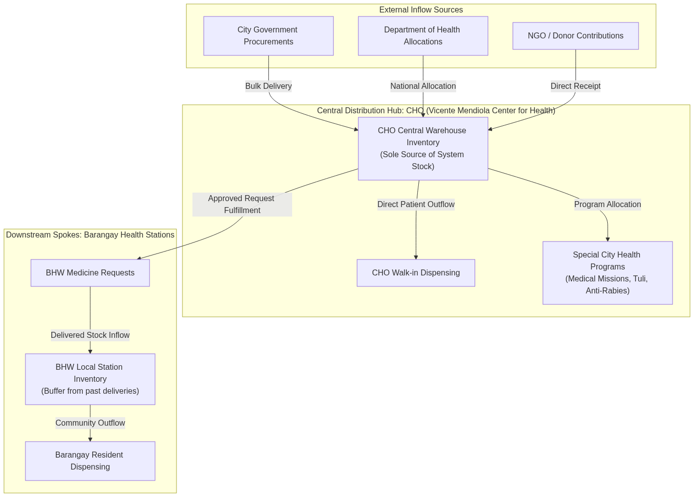
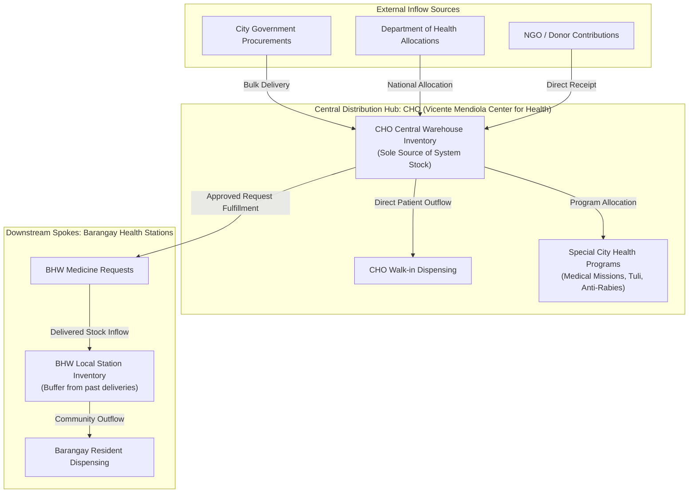
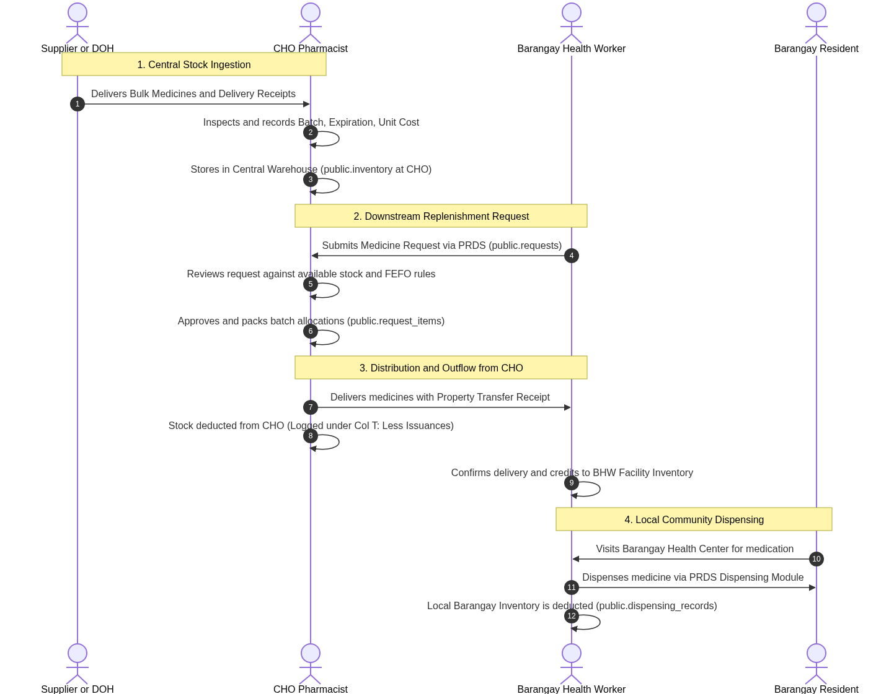
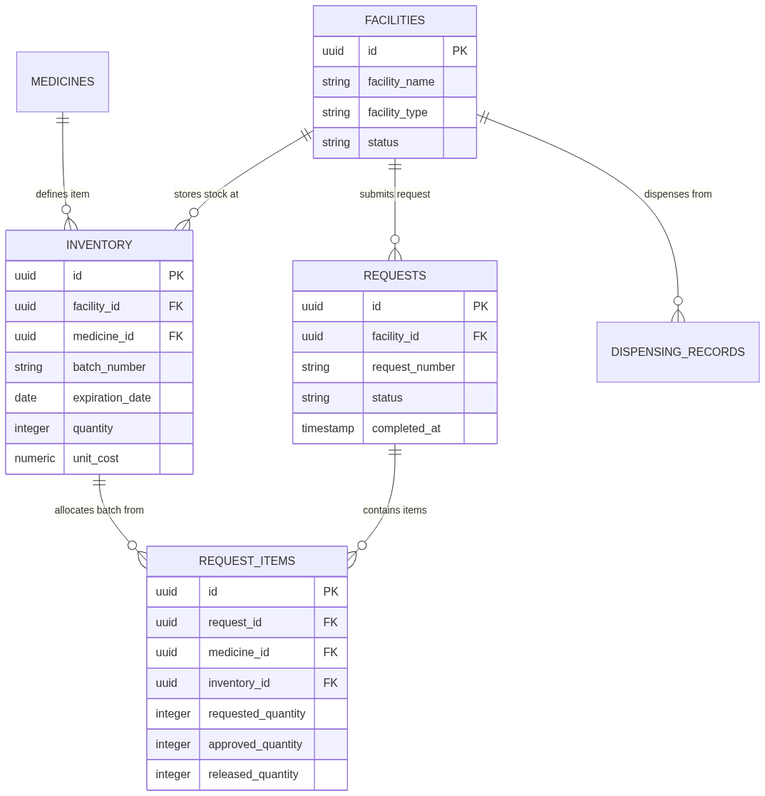
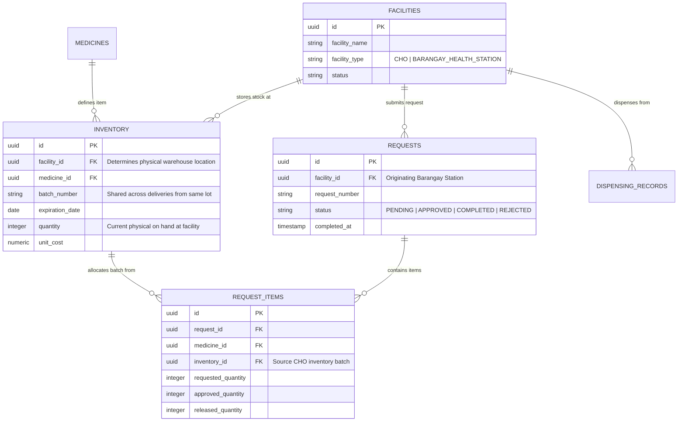

# City of Naga Inventory Workflow Architecture

**Document Version:** 1.0  
**Effective Date:** October 2026  
**System:** Pharmaceutical Resources Distribution System (PRDS)  
**Jurisdiction:** City Health Office (CHO) – Vicente Mendiola Center for Health, City of Naga, Cebu  

---

## 1. Executive Overview

The Pharmaceutical Resources Distribution System (PRDS) operates on a centralized **Hub-and-Spoke Distribution Model**. In this architecture, the **City Health Office (CHO / Vicente Mendiola Center for Health)** serves as the central operational hub, sole procurement recipient, and primary warehouse depot, while the various **Barangay Health Stations (BHW Stations)** function as downstream service spokes that receive allocations exclusively through structured medicine requests.

This document formalizes the inventory movement rules, downstream replenishment logic, and reporting boundaries governing pharmaceutical supply management across the City of Naga.



<details>
<summary>View Mermaid Diagram Source</summary>



</details>

---

## 2. Core Supply Chain Principles

### Principle 1: Single Source of Truth (CHO Sole Intake)
* All pharmaceutical supplies entering the PRDS ecosystem **must be received and logged exclusively at the CHO central warehouse**.
* Barangay Health Stations **do not have independent procurement authority** or direct vendor intake mechanisms in the system.
* Every unit of medicine in any barangay health station across the city traces its origin to a verified batch receipt at the CHO.

### Principle 2: Demand-Driven Downstream Replenishment
* BHW inventory is augmented **strictly through formal Medicine Requests** submitted via the BHW Portal to the CHO.
* A BHW station's inventory cannot increase through manual adjustments or direct entries; stock is credited to the barangay only upon **fulfillment and delivery confirmation** of an approved request.

### Principle 3: Fulfillment Precondition (Available CHO Stock)
* The CHO cannot distribute or release medicines that are not physically present and unreserved in the CHO central inventory.
* When a BHW submits a request:
  - If $\text{CHO Available Stock} = 0$, the request cannot be approved for release.
  - If $\text{CHO Available Stock} < \text{Requested Quantity}$, the CHO can approve a partial allocation based on existing stock while safeguarding warehouse reserve minimums.

### Principle 4: Local Station Inventory Lifespan
* The inventory physically residing at a Barangay Health Station at any point in time represents **the unconsumed balance remaining from past approved CHO deliveries**.
* When BHWs dispense medicines to barangay residents, the stock is deducted directly from that barangay station's local inventory record.

---

## 3. End-to-End Inventory Movement Lifecycle



<details>
<summary>View Mermaid Diagram Source</summary>

```mermaid
sequenceDiagram
    autonumber
    actor Supplier as Supplier / DOH
    actor CHO as CHO Pharmacist / Staff
    actor BHW as Barangay Health Worker
    actor Citizen as Barangay Resident

    Note over Supplier,CHO: 1. Central Stock Ingestion
    Supplier->>CHO: Delivers Bulk Medicines & Delivery Receipts (DR/IAR)
    CHO->>CHO: Inspects, records Batch/Lot No, Expiration Date, Unit Cost
    CHO->>CHO: Stores in CHO Central Warehouse (public.inventory @ CHO)

    Note over CHO,BHW: 2. Downstream Replenishment Request
    BHW->>CHO: Submits Medicine Request via PRDS (public.requests)
    CHO->>CHO: Reviews request against CHO available stock & FEFO priorities
    CHO->>CHO: Approves & packs batch allocations (public.request_items)

    Note over CHO,BHW: 3. Distribution & Outflow from CHO
    CHO->>BHW: Delivers medicines with Property/Transfer Receipt
    CHO->>CHO: Stock is deducted from CHO (Logged under Col T: "Less Issuances")
    BHW->>BHW: Confirms delivery; stock is credited to BHW Facility Inventory

    Note over BHW,Citizen: 4. Local Community Dispensing
    Citizen->>BHW: Visits Barangay Health Center for medication
    BHW->>Citizen: Dispenses medicine via PRDS Dispensing Module
    BHW->>BHW: Local Barangay Inventory is deducted (public.dispensing_records)
```

</details>

### Detailed Movement Breakdown:

| Stage | Process | System Action | Inventory Impact |
| :--- | :--- | :--- | :--- |
| **1. Stock Ingestion** | Bulk delivery from suppliers or DOH | Received at CHO via Inventory Module | **(+) Increases CHO Inventory** (Recorded under Additions / Inflows, Cols L–N) |
| **2. Walk-in Dispensing** | Patient visits CHO clinic | Dispensed directly at CHO pharmacy | **(-) Deducted from CHO Inventory** (Recorded under Regular Issuances, Cols T–V) |
| **3. Special Health Programs** | Medical mission, Operation Tuli, Anti-Rabies | Stock allocated to health campaign | **(-) Deducted from CHO Inventory** (Recorded under Other Programs, Cols X–AA) |
| **4. BHW Request Approval & Delivery** | Barangay station requests supplies | CHO approves and delivers batch | **(-) Deducted from CHO Inventory** (Recorded under Regular Issuances, Cols T–V) <br/>**(+) Added to BHW Station Inventory** |
| **5. Barangay Dispensing** | Patient receives medicine at barangay | Dispensed by BHW at barangay station | **(-) Deducted from BHW Station Inventory** (No effect on CHO central warehouse) |
| **6. Condemnation / Expiry** | Batch passes expiration date | Identified by system cutoff | **(-) Deducted from Physical Count** (Transferred to Expired Stocks, Cols AC–AE) |

---

## 4. Reporting & Statutory Reconciliation Implications

The architectural distinction between **Central CHO Warehouse Stock** and **Distributed BHW Station Stock** governs how statutory reports—specifically the **Monthly Physical Count & Stock Reconciliation Ledger (`inventory-form.xlsx`)**—must be structured.

### 4.1 The Scope of the Monthly Inventory Report
* **Facility Scope**: The statutory Monthly Physical Count Ledger represents the **Vicente Mendiola Center for Health (City Health Office)** as the central accounting entity.
* **Physical Shelf Verification**: The ledger is designed for physical inventory audits. When an auditor or pharmacist walks the warehouse aisles with the ledger, **the quantities on the paper must match the physical boxes on the CHO shelves**.

### 4.2 Resolving Ledger Redundancy (Why BHW Records Must Not Be Aggregated)

In an unconstrained database query (`facility_id = ALL`), pulling raw inventory produces duplicate rows for the same medicine and lot number:

```
Example: Acetylcysteine 200 mg (Lot 4324FA4)
- Row 1: CHO Warehouse            --> Qty: 110 (Physical stock on CHO shelf)
- Row 2: Barangay Sub-station 1   --> Qty:  20 (Delivered from past request)
- Row 3: Barangay Sub-station 2   --> Qty:  39 (Delivered from past request)
Total in Unfiltered Query: 3 separate rows showing Lot 4324FA4
```

#### Why This Violates Accounting Integrity:
1. **Double Accounting of Issued Goods**: The 20 and 39 units delivered to the barangays were **already recorded as Issuances (Outflows)** from the CHO when the requests were fulfilled. Listing the barangay stations' remaining balances in the CHO ledger causes those units to be counted twice.
2. **Physical Count Discrepancy**: A CHO pharmacist counting physical boxes on the CHO warehouse shelf will only find **110 tablets**. If the ledger lists 3 rows totaling 169 tablets, the physical audit fails.

#### Standard Rule for the Monthly Ledger:
$$\text{Ledger Scope} = \text{Inventory records where } \mathbf{facility\_id = CHO\_FACILITY\_ID}$$

$$\text{Remaining Balance (Col AG)} = \text{Gross Available at CHO} - (\text{Walk-in Issuances} + \mathbf{BHW\ Request\ Deliveries} + \text{Other Programs} + \text{Expired})$$

* **BHW Allocations**: Fully and accurately captured under **Column T ("Less Issuances")** under the *Barangay Requests* component.
* **Warehouse Balance**: Reflects only the stock physically remaining at the CHO facility.

---

## 5. Database Schema & State Mapping

The relationship between central inventory, request fulfillment, and local stock is maintained across the following database models:



<details>
<summary>View Mermaid Diagram Source</summary>



</details>

---

## 6. Summary Matrix: Facility Roles & Capabilities

| Operational Capability | City Health Office (CHO Central Hub) | Barangay Health Station (BHW Spoke) |
| :--- | :---: | :---: |
| **Accept External Vendor Deliveries** |  **Yes** (Sole intake point) | ❌ **No** |
| **Accept DOH Program Deliveries** |  **Yes** | ❌ **No** |
| **Create New Medicine Batches** |  **Yes** | ❌ **No** (Inherited from CHO batch) |
| **Dispense to Walk-in Patients** |  **Yes** (Central clinic) |  **Yes** (Barangay residents) |
| **Allocate to Special Health Campaigns** |  **Yes** (Medical missions, etc.) | ❌ **No** |
| **Submit Replenishment Requests** | ❌ **No** (Origin of stock) |  **Yes** (Requests to CHO) |
| **Approve & Fulfill Requests** |  **Yes** | ❌ **No** |
| **Statutory Monthly Inventory Form** |  **Yes** (Full 6-stage physical count) | ❌ Sub-station stock ledger only |
