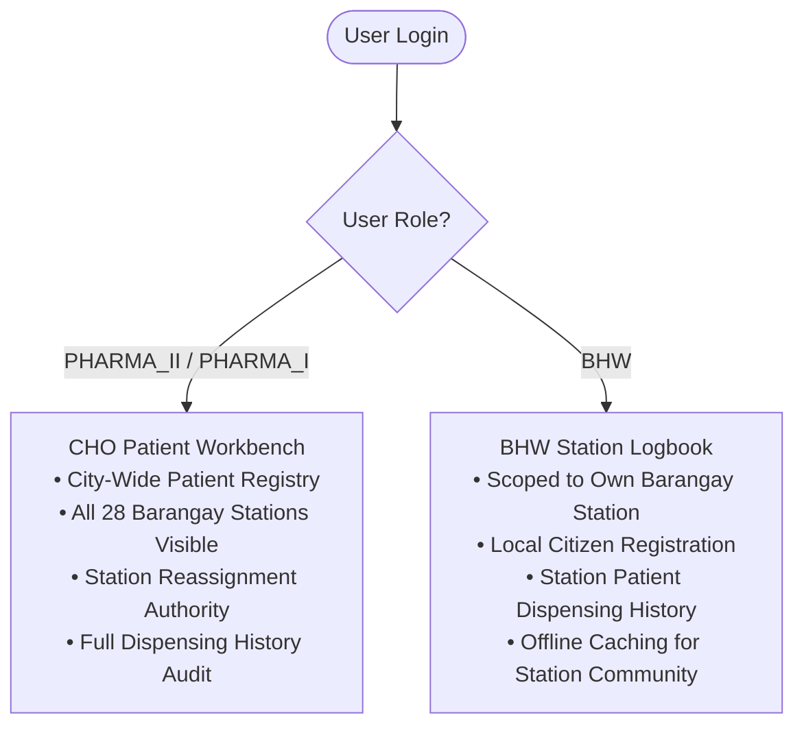
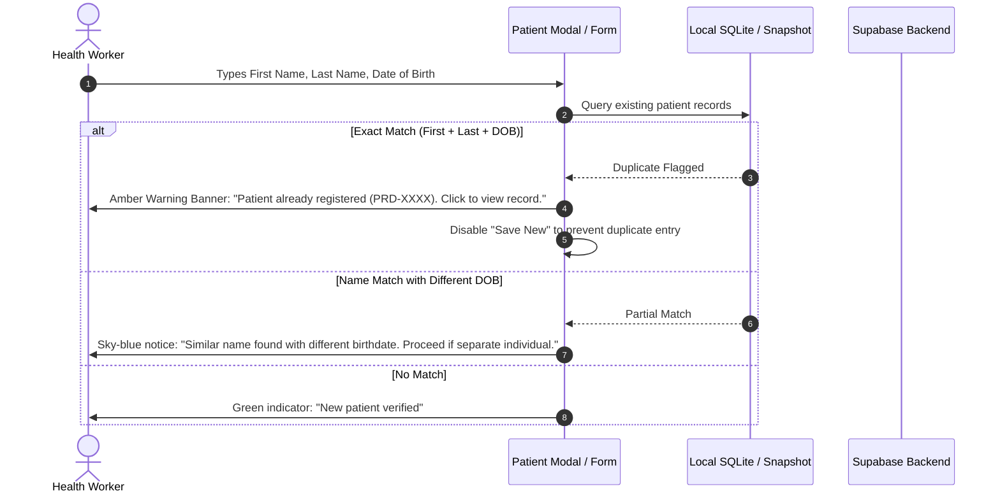

# Patient Management & Clinical Registration Flow

> **Document Type:** Application Architecture & Clinical Workflow Specification  
> **Target Module:** Patient Registry (`prds-desktop/src/frontend/views/patients/`)  
> **Target Roles:** City Health Office Pharmacists (`PHARMA_II`, `PHARMA_I`), Barangay Health Workers (`BHW`)  
> **Status:** Active & Implemented in PRDS Desktop  

---

## 1. System Overview & Healthcare Context

The **Patient Management Module** functions as the central clinical demographic registry for the Pharmaceutical Resources Distribution System (PRDS) across the **City Health Office (CHO / Vicente Mendiola Center for Health)** and the **28 Barangay Health Stations (BHS)** of the City of Naga, Cebu.

### Core Objectives:
1. **Bonafide Citizen Verification:** Confirms patient residency within the City of Naga before issuing government-subsidized pharmaceutical supplies.
2. **Unique Patient Identification:** Automatically generates a standardized, sequential clinical identifier (`PRD-XXXX`) per citizen.
3. **Equitable Distribution & Over-Dispensing Prevention:** Provides health workers with full cross-facility dispensing logs to verify that patients do not claim free medicines multiple times within restricted clinical cooldown windows.
4. **Offline Patient Profiling:** Allows BHWs to search, register, and update patient demographics on field laptops during rural consultations without internet connectivity.

---

## 2. Role-Based Scoping & Visibility

PRDS strictly partitions patient records based on role authority and geographic health station assignment:



| Operational Dimension | City Health Office (`PHARMA_II` / `PHARMA_I`) | Barangay Health Worker (`BHW`) |
| :--- | :--- | :--- |
| **Visible Patients** | **City-Wide:** All registered patients across all 28 barangays. | **Station-Scoped:** Only patients assigned to their own health center. |
| **Registration Authority** | Can register walk-in patients and assign them to any barangay. | Registers residents of their assigned barangay. |
| **Facility Filter** | Dropdown filter to isolate specific barangay stations. | Fixed to assigned facility; no cross-station selector. |
| **Dispensing Verification** | Audits municipal-wide dispensing history across all facilities. | Checks recent dispensing history for station patients. |

---

## 3. Patient Data Structure & Automated Coding

### 3.1 Sequential Patient Code (`patient_code`)
Every patient registered in the system is assigned an immutable, human-readable clinical code formatted as:
```text
PRD-0001, PRD-0002, ..., PRD-9999
```
* **Database Sequence:** Generated server-side using PostgreSQL sequence `patient_code_seq`.
* **Zero-Collision Guarantee:** Enforced via a `BEFORE INSERT` trigger on the `patients` table:
  ```sql
  NEW.patient_code := 'PRD-' || lpad(nextval('patient_code_seq')::text, 4, '0');
  ```
* **Client-Side Temporary IDs:** When operating offline, the client generates a cryptographic UUID and assigns a temporary local code (`PRD-OFF-XXXX`) until reconnection, at which point the server allocates the permanent sequence number.

### 3.2 Field Specifications & Validation Rules

| Attribute | Database Column | Constraints & Rules |
| :--- | :--- | :--- |
| **First Name** | `first_name` | Required, capitalized, sanitized for SQL/XSS safety. |
| **Middle Name** | `middle_name` | Optional. |
| **Last Name** | `last_name` | Required, capitalized. |
| **Suffix** | `suffix` | Optional (e.g. *Jr., Sr., III*). |
| **Gender** | `gender` | Enum: `MALE`, `FEMALE`. |
| **Date of Birth** | `date_of_birth` | Required; cannot be in the future. Auto-calculates age in UI. |
| **Contact Number** | `contact_number` | Optional; validated to Philippine format (`09XXXXXXXXX` / `+639XXXXXXXXX`). |
| **Address** | `address` | Required street, purok, or sitio address. |
| **Facility** | `facility_id` | Foreign key referencing `facilities.id`. |
| **PhilHealth ID** | `philhealth_id` | Optional 12-digit standard healthcare identification number. |

---

## 4. Deduplication & Verification Pipeline

To maintain clean clinical records and prevent duplicate registrations:



---

## 5. Integration with Dispensing & Reporting

The Patient Management module directly feeds clinical and operational workflows across PRDS:

1. **Point-of-Sale Dispensing (`/dispensing`):**
   - Health workers select the patient from an instant-search autocomplete dropdown.
   - The UI immediately surfaces the patient's **Recent Dispensing Log**, showing whether prescribed medicines were already claimed this week or month.
   - FEFO batch deduction automatically links the transaction to `patient_medicine_records`.
2. **Daily Dispensing Report (RIS):**
   - Patient names, addresses, and demographic categories (Senior Citizen, PWD, General Public) populate the official daily Request & Issuance Slip.
3. **Forecasting & Demand Tracking (`/forecasting`):**
   - Aggregated monthly dispensing records grouped by patient demographics enable linear regression algorithms to project upcoming seasonal medicine requirements across each barangay station.
