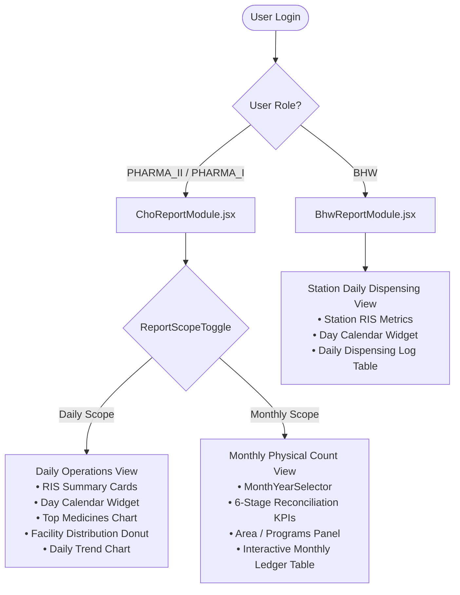
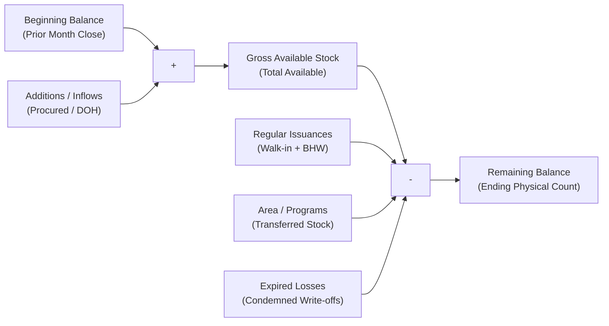

# Report Module Components & Interpretation Guide

> **Document Type:** Application Architecture, UI Component Reference & Clinical Interpretation Guide  
> **Target Module:** Report Module (`prds-desktop/src/frontend/views/reports`)  
> **Target Roles:** City Health Office (CHO) Pharmacists (`PHARMA_II`, `PHARMA_I`), CHO Head Doctor, Barangay Health Workers (`BHW`)  
> **Source Excel Templates:**
> - Monthly Physical Count: [`inventory-form.xlsx`](file:///d:/prds/prds-desktop/src/frontend/assets/templates-excel/inventory-form.xlsx)
> - Daily Dispensing Slip: [`RIS-Template.xlsx`](file:///d:/prds/prds-desktop/src/frontend/assets/templates-excel/RIS-Template.xlsx)  
> - Companion Accounting & Column Specification: [CHO Inventory Physical Count Report Plan and Analysis.md](./CHO%20Inventory%20Physical%20Count%20Report%20Plan%20and%20Analysis.md)  
> **Status:** Active & Implemented in PRDS Desktop

---

## 1. System Overview & Role-Based Scope

The **Report Module** is the central clinical and financial auditing hub of the PRDS application. It provides real-time operational metrics, interactive physical count reconciliations, and one-click official Excel exports matching statutory Local Government Unit (LGU), Commission on Audit (COA), and Department of Health (DOH) formats.

### 1.1 Role-Based Access Matrix

| Role | Label | Operational Scope | Available View Modes |
| :--- | :--- | :--- | :--- |
| **`PHARMA_II`** | Pharmacist II (Chief) | City Health Office oversight across all 28 Barangay Health Stations. Audits monthly reconciliations and signs statutory reports. | **Both** Daily & Monthly. |
| **`PHARMA_I`** | Pharmacist I (CHO Operational) | Manages daily walk-in pharmacy dispensing, fulfills barangay requests, and assists with physical inventory counts. | **Both** Daily & Monthly. |
| **`BHW`** | Barangay Health Worker | Facility-scoped dispensing at a specific Barangay Health Center (e.g. Barangay Colon Health Center). | **Daily Only** for their assigned station. |



---

## 2. Navigation & Scope Switching Architecture

### 2.1 Component: `ReportScopeToggle.jsx`
- **Location:** [`prds-desktop/src/frontend/views/reports/components/ReportScopeToggle.jsx`](file:///d:/prds/prds-desktop/src/frontend/views/reports/components/ReportScopeToggle.jsx)
- **Role:** High-level segmented switch located at the top of the module allowing CHO pharmacists to alternate between operational day-to-day dispensing logs and month-end statutory stock reconciliation.

```
+----------------------------------------------------------------------------------------+
|  [ 📅 Daily ]     [ 📊 Monthly ]                                                       |
+----------------------------------------------------------------------------------------+
```

#### How to Interpret:
1. **`Daily` (Daily Dispensing Operations / RIS)**:
   - Use this mode for **daily verification**. It answers: *"What medicines were given to walk-in patients today, what was delivered to barangay health stations today, and what was today's total pharmaceutical disbursement value?"*
2. **`Monthly` (Monthly Physical Count & Stock Reconciliation)**:
   - Use this mode for **monthly auditing and month-end closing**. It answers: *"Did our warehouse stock balance this month? How much was on hand on Day 1, how much was procured, how much was dispensed, how much went to outreach drives like Anti-Rabies or Operation Tuli, and what is our remaining ending balance?"*

---

## 3. Daily Operations (RIS) Scope: Components & Interpretation

When in **Daily Operations (RIS)** mode, the interface focuses on immediate clinical distribution for a selected single day.

```
+-------------------------------------------------------------------------------------------------------------------+
| [ReportHeader] Reports & Distribution Slips                         Facility: [ All Health Centers v ] [Date] [Export]
+-------------------------------------------------------------------------------------------------------------------+
| [ReportSummaryCards (4 Cards)]                                    | [ReportCalendarWidget]                         |
| 1. Dispensed Today: 587 Units (Walk-in: 120 | BHW: 467)           |   <  October 2026  >                           |
| 2. Total Medicine Cost: ₱ 18,450.50                               |   Mo Tu We Th Fr Sa Su                         |
| 3. Total Remaining Stock: ₱ 342,890.00                            |   -- -- --  1  2  3  4                         |
| 4. Low Stock Warning: 3 Medicines Low (Restock Recommended)       |   [ Today: Oct 2, 2026 ]                       |
+-------------------------------------------------------------------+------------------------------------------------+
| [TopMedicinesChart (7 Cols)]                                      | [FacilityDistributionChart (5 Cols)]           |
| Ranked horizontal bar chart of top 5 dispensed items today        | Donut chart: CHO In-House (21%) vs BHWs (79%)  |
+-------------------------------------------------------------------------------------------------------------------+
| [DailyTrendChart (Full Width)]                                                                                    |
| Bar chart tracking daily dispensed volume across every day of the selected month                                  |
+-------------------------------------------------------------------------------------------------------------------+
```

### 3.1 Component: `ReportHeader.jsx`
- **Location:** [`prds-desktop/src/frontend/views/reports/components/ReportHeader.jsx`](file:///d:/prds/prds-desktop/src/frontend/views/reports/components/ReportHeader.jsx)
- **Controls:**
  - **Facility Filter Dropdown (Daily Scope only for CHO):** Allows filtering operational dispensing metrics to `"All Health Centers"`, City Health Office (`VMCH`), or any of the 28 individual Barangay Health Stations. *(Automatically hidden in Monthly view because monthly physical counts are strictly scoped to the City Health Office warehouse).*
  - **Date Badge (Daily Scope only):** Displays the active reporting date (e.g. `October 2, 2026`). *(Hidden in Monthly view where reporting period is controlled by `MonthYearSelector`).*
  - **Export Action:** Direct one-click download for `Export to Excel (RIS)` or dropdown for CHO users (`Daily Dispensing Slip (RIS)` vs `Monthly Inventory Form`).

### 3.2 Component: `ReportCalendarWidget.jsx`
- **Location:** [`prds-desktop/src/frontend/views/reports/components/ReportCalendarWidget.jsx`](file:///d:/prds/prds-desktop/src/frontend/views/reports/components/ReportCalendarWidget.jsx)
- **Role:** Interactive clinical day-picker. Clicking any day immediately recalculates all daily KPI cards and daily charts.
- **Controls:** Month jumper `< >`, Month dropdown, and `[ Today ]` shortcut button.

### 3.3 Component: `ReportSummaryCards.jsx` (4 Daily KPIs)
- **Location:** [`prds-desktop/src/frontend/views/reports/components/ReportSummaryCards.jsx`](file:///d:/prds/prds-desktop/src/frontend/views/reports/components/ReportSummaryCards.jsx)

| KPI Card | Metric Displayed | Clinical / Operational Interpretation |
| :--- | :--- | :--- |
| **1. Medicines Dispensed Today** | Total Units (e.g. `587 Units`) | Cumulative pharmaceutical items distributed today. Includes sub-counts separating walk-in patients from barangay station fulfillments. |
| **2. Total Medicine Cost** | Currency (e.g. `₱ 18,450.50`) | $\sum (\text{Quantity Dispensed} \times \text{Unit Cost})$. Represents the government financial value of healthcare goods released today. |
| **3. Total Remaining Stock** | Currency (e.g. `₱ 342,890.00`) | Asset value of active batches currently resting on the shelves of the selected facility. |
| **4. Low Stock Warning** | Alert Status / Count | Flags items whose inventory count has fallen below minimum safety thresholds ($\le 20$ units), listing specific medicines needing replenishment. |

### 3.4 Daily Analytical Visualizations
1. **`TopMedicinesChart.jsx`:** Horizontal ranked bar chart showing the 5 most demanded medicines on the selected date. Used by pharmacists to spot disease outbreak patterns (e.g., sudden spikes in Paracetamol or Co-Amoxiclav).
2. **`FacilityDistributionChart.jsx`:** Donut chart showing the proportion of supplies dispensed directly at the CHO walk-in clinic versus bulk distributions to Barangay Health Stations.
3. **`DailyTrendChart.jsx`:** 31-day bar graph showing day-by-day dispensing intensity across the entire month, allowing pharmacists to observe peak dispensing days (typically clinic consultation days).

---

## 4. Monthly Physical Count Scope: Components & Interpretation

When switching to **Monthly** mode, the entire module transforms into the official statutory stock ledger matching [`inventory-form.xlsx`](file:///d:/prds/prds-desktop/src/frontend/assets/templates-excel/inventory-form.xlsx).

```
+-------------------------------------------------------------------------------------------------------------------+
| [MonthYearSelector] Month: [ October  v ] Year: [ 2026 v ] [ < Prev ] [ Current ] [ Next > ]                      |
|                     Period: October 1, 2026 – October 31, 2026 (31 Days)                                          |
+-------------------------------------------------------------------------------------------------------------------+
| [MonthlyReconciliationKpis (6 Cards)]                                                                             |
| [Beg Balance]     [Additions]       [Issuances]       [Area/Programs]     [Expired]       [Remaining Balance]     |
|   ₱ 324,500.00      ₱ 85,200.00       ₱ 62,450.00       ₱ 18,320.00         ₱ 1,420.00      ₱ 327,510.00      |
|   1,240 Units       350 Units         280 Units         65 Units            8 Units         1,237 Units [OK]  |
+-------------------------------------------------------------------------------------------------------------------+
| [AreaProgramsAllocationPanel] Transferred to Other Programs                                                        |
| Other Programs Grid:                                       | Other Programs Cost Breakdown:                         |
| - [Anti-Rabies Drive]       ₱ 8,450.00 (25 Vials Verorab)  | ■ Anti-Rabies Drive (46.1%)                            |
| - [Operation Tuli 2026]     ₱ 4,120.00 (15 Bx Lidocaine)   | ■ Operation Tuli    (22.5%)                            |
| - [Mobile Dental Mission]   ₱ 2,800.00 (12 Bx Mefenamic)   | ■ Mobile Dental     (15.3%)                            |
| [see more]                                                 |                                                        |
| (Click any program card to filter the ledger table below)  | TOTAL OTHER PROGRAMS COST: ₱ 18,320.00 (65 Units)      |
+-------------------------------------------------------------------------------------------------------------------+
| [MonthlyInventoryLedgerTable]                                                                                     |
| Search: [ Search name, brand, lot... ] Filter: [ All Items v ] View: [ Full Ledger | Condensed v ]                |
| High-density table preview matching the official inventory-form.xlsx workbook                                     |
| Sticky Total Row: Total Beg: ₱324,500 | Add: ₱85,200 | Issued: ₱62,450 | Programs: ₱18,320 | Rem: ₱327,510.00     |
+-------------------------------------------------------------------------------------------------------------------+
```

### 4.1 Component: `MonthYearSelector.jsx` (Monthly Period Controller)
- **Location:** [`prds-desktop/src/frontend/views/reports/components/MonthYearSelector.jsx`](file:///d:/prds/prds-desktop/src/frontend/views/reports/components/MonthYearSelector.jsx)
- **Controls:**
  - **Month & Year Dropdowns:** Select any calendar month (`January` through `December`) and year (`2022`–`2028`).
  - **Quick Jump Buttons:** `< Previous Month`, `Current Month`, and `Next Month >`.
  - **Coverage Banner:** Automatically displays the exact calendar date range for the active reporting period:
    - *Reporting Period:* `Period: [Month] 1, [Year] – [Month] [LastDay], [Year] ([NumDays] Days)`.
  - **Statutory Excel Date Headers:** Aligned with `inventory-form.xlsx`, the specific reconciliation anchor dates are rendered directly within the on-screen ledger table headers:
    - `BEGINNING BALANCE AS OF [PREVIOUS_MONTH_LAST_DAY, YEAR]`
    - `REMAINING BALANCE AS OF [REPORTING_MONTH_LAST_DAY, YEAR]`

---

### 4.2 Component: `MonthlyReconciliationKpis.jsx` (The 6-Stage Accounting Flow)
- **Location:** [`prds-desktop/src/frontend/views/reports/components/MonthlyReconciliationKpis.jsx`](file:///d:/prds/prds-desktop/src/frontend/views/reports/components/MonthlyReconciliationKpis.jsx)

The physical count inventory form follows the **Law of Conservation of Inventory**:

$$\begin{aligned}
\text{Gross Available} &= \text{Beginning Balance} + \text{Additions} \\
\text{Remaining Balance} &= \text{Gross Available} - (\text{Issuances} + \text{Other Programs} + \text{Expired})
\end{aligned}$$



#### Detailed KPI Breakdown:

| Card | Excel Columns | Formula / Business Meaning | Interpretation Guide |
| :--- | :--- | :--- | :--- |
| **Beginning Balance** | Cols **I, J, K** | Stock count & valuation on Day 1 of target month ($\sum K$). | Represents opening assets inherited from prior month close. |
| **Additions (Inflows)** | Cols **L, M, N** | Procurements, DOH/NGO donations, and barangay returns received during the month ($\sum N$). | Measures inventory influx. If high, indicates new bulk procurement or national DOH vaccine deliveries. |
| **Regular Issuances** | Cols **T, U, V** | Dispensed to walk-in patients and barangay clinic requests ($\sum V$). | Reflects standard public healthcare delivery consumption across the city. |
| **Area / Programs** | Cols **X, Y, Z, AA** | Stock issued to programs recorded in the Other Programs module ($\sum Z$). | Tracks specialized public health program distributions (e.g. Anti-Rabies, Mobile Dental, Operation Tuli). |
| **Expired Losses** | Cols **AC, AD, AE** | Quarantined batches reaching expiration this month ($\sum AE$). | Quantifies financial loss due to spoilage. Used by management to audit FEFO compliance. |
| **Remaining Balance** | Cols **AG, AH, AI** | Final physical count on hand at month close ($\sum AI$). | Net ending inventory. Automatically verified with a **`[ Balanced (OK) ]`** status pill if conservation formula matches. |

---

### 4.3 Component: `AreaProgramsAllocationPanel.jsx` (Transferred to Other Programs)
- **Location:** [`prds-desktop/src/frontend/views/reports/components/AreaProgramsAllocationPanel.jsx`](file:///d:/prds/prds-desktop/src/frontend/views/reports/components/AreaProgramsAllocationPanel.jsx)
- **Relevance to Excel Template:** This component directly visualizes **Excel Columns X, Y, Z, and AA** (`TRANSFERRED TO OTHER PROGRAMS` & `AREA / PROGRAM`).
- **Connection to PRDS Modules:** Corresponds to records managed under the **Other Programs** sidebar module (`other_programs` and `program_medicines`).

#### Why "Transferred to Other Programs" Matters:
The City Health Office (CHO) conducts targeted health campaigns outside routine clinic walk-in consultations. When medicines are issued to these programs (e.g., Anti-Rabies, Medical Missions, Operation Tuli, Mobile Dental), they must be audited distinctly so that program coordinators account for their assigned supplies and the stock is formally reconciled against physical inventory.

#### Features & Interpretation:
1. **Other Programs Grid (Left Side):**
   - Displays a card for each program recorded in `other_programs` for the selected month.
   - Shows program title, target location (e.g., *City of Naga*), date, and specific **Program Medicines** transferred.
   - Shows **Total Cost** ($= \sum \text{Quantity} \times \text{Unit Cost}$) allocated to that program.
   - **De-cluttering with "see more":** When there are 5 or more programs in a month, the grid shows the top 4 cards with a **`see more`** text link. Clicking `see more` expands the full list, and toggles to `see less` to collapse back.
2. **Other Programs Cost Breakdown (Right Side):**
   - **TOTAL OTHER PROGRAMS COST:** Total financial valuation ($\sum \text{Col Z}$) of all medicines transferred to programs this month.
   - **Total Quantity Transferred:** Total physical units ($\sum \text{Col X}$) issued across all programs.
   - **Percentage Distribution Bars:** Shows the proportional cost share consumed by each program (e.g., *Medical Mission: 90%*, *TULI: 10%*).
3. **Interactive Cross-Filtering:**
   - **Clicking any program card immediately filters the Monthly Inventory Ledger Table below** to show only the specific medicines and inventory rows assigned to that program.
   - An active filter pill appears with a `Clear filter` button to reset the table.

---

### 4.4 Component: `MonthlyInventoryLedgerTable.jsx` (Interactive Table Preview)
- **Location:** [`prds-desktop/src/frontend/views/reports/components/MonthlyInventoryLedgerTable.jsx`](file:///d:/prds/prds-desktop/src/frontend/views/reports/components/MonthlyInventoryLedgerTable.jsx)
- **Role:** High-density on-screen ledger replicating all 35 columns of [`inventory-form.xlsx`](file:///d:/prds/prds-desktop/src/frontend/assets/templates-excel/inventory-form.xlsx).

#### Column Architecture:

```
[SECTION 0: MEDICINE IDENTIFICATION (Cols C-H)]
ITEM NO | ITEM DESCRIPTION | UNIT | BRAND | LOT NO | EXPIRY DATE

[SECTION 1: BEGINNING BALANCE (Cols I-K)]
QUANTITY | UNIT COST | TOTAL COST (=I*J)

[SECTION 2: ADDITIONAL STOCKS (Cols L-N)]
QUANTITY | UNIT COST | TOTAL COST (=L*M)

[SECTION 3: SUMMATION (GROSS) (Cols P-R)]
QUANTITY | UNIT COST | TOTAL COST (=P*Q)

[SECTION 4: LESS: ISSUANCES (Cols T-V)]
QUANTITY | UNIT COST | TOTAL COST (=T*U)

[SECTION 5: TRANSFERRED TO OTHER PROGRAMS (Cols X-AA)]
QUANTITY | UNIT COST | TOTAL COST (=X*Y) | AREA / PROGRAM (Col AA)

[SECTION 6: EXPIRED (Cols AC-AE)]
QUANTITY | UNIT COST | TOTAL COST (=AC*AD)

[SECTION 7: REMAINING BALANCE (Cols AG-AI)]
QUANTITY | UNIT COST | TOTAL COST (=AG*AH)
```

#### Toolbar Features & Interpretation:
1. **Search Input:** Real-time search by generic formulation, brand name, lot number, or program title.
2. **Filter Pills:**
   - `All Items`: Complete inventory catalog.
   - `With Issuances`: Items that experienced patient or barangay consumption.
   - `Program Transferred`: Items diverted to outreach campaigns (Col AA).
   - `Low Stock (≤20)`: Items requiring immediate purchase requisition.
   - `Expired`: Items quarantined for disposal write-off.
3. **View Mode Toggle:**
   - `Full Ledger`: Renders all 8 accounting sections for comprehensive auditing.
   - `Condensed View`: Collapses spacer and intermediate calculation columns, showing Item Details, Beginning Balance, Total Outflows, and Ending Balance for executive scanning.
4. **Statutory Date Anchors in Table Headers (Matching Official Excel Form):**
   - **Beginning Balance (`Cols I-K`):** Always reflects the prior month's closing date (e.g., `AS OF SEPTEMBER 30, 2026` for an October 2026 report). This establishes the immutable baseline carried over into the current period.
   - **Remaining Balance (`Cols AG-AI` - Adaptive Stamping):**
     - **Current In-Progress Month:** When viewing or exporting the active current month, it dynamically stamps the **active day** (e.g., `AS OF OCTOBER 2, 2026`). Under COA/LGU audit guidelines, a physical inventory count reflects stock on hand at the precise date of inspection; stamping a future end-of-month date prior to month-end is an audit violation.
     - **Closed Historical Month:** When reviewing closed past periods, it stamps the official month-end closing date (e.g., `AS OF SEPTEMBER 30, 2026`).
5. **Sticky Totals Row (Row N+1):**
   - Labeled **`TOTAL`** (matching cell `D10` of `inventory-form.xlsx`). Sums all financial valuation columns ($K, N, R, V, Z, AE, AI$) to provide the bottom-line numbers needed for statutory COA reports.
6. **Pagination:** Displays 20 records per page with fast page-switching for responsive performance.

---

## 5. Official Excel Exports & Regulatory Compliance Rules

PRDS provides automated Excel generation with pixel-perfect preservation of official government templates:

### 5.1 Daily RIS Workbook (`RIS-Template.xlsx`)
- **Generated File:** `Request_Issuance_Slip_YYYY-MM-DD.xlsx`
- **Dual-Sheet Structure:**
  - `Sheet 1 (CHO)`: Direct walk-in patient dispensing at the City Health Office. Header labeled: **`"PHARMACY DISPENSING"`**.
  - `Sheet 2 (BHW)`: Medicines issued to barangay health centers. Header labeled with receiving station (e.g. **`"BARANGAY COLON HEALTH CENTER"`**).
- **Compliance Rules:**
  - **RIS Number:** Left blank on export (client logs this manually).
  - **Signatory Blocks:** Left blank for physical ink signature and verification stamp.

### 5.2 Monthly Inventory Form (`inventory-form.xlsx`)
- **Generated File:** `Physical_Count_Inventories_YYYY_MM.xlsx`
- **Grid Offset & Column Span:** Starts strictly at **Column C** and ends at **Column AI**, preserving template margins (Columns A and B are blank margins).
- **Adaptive Date Headers (Cell `C5` & `AG5`):**
  - **Cell `I5` (Beginning Balance):** Always reflects the prior month's closing date (`BEGINNING BALANCE AS OF \n[PREVIOUS_MONTH] [LAST_DAY], [YEAR]`).
  - **Cell `C5` (Month Title) & Cell `AG5` (Remaining Balance):**
    - **Current In-Progress Month:** Adaptively stamped with the **exact export day** (e.g. `MONTH : OCTOBER 2, 2026` and `REMAINING BALANCE  AS OF \nOCTOBER 2, 2026`).
    - **Closed Past Month:** Stamped with the official month-end closing day (e.g. `MONTH : SEPTEMBER 30, 2026` and `REMAINING BALANCE  AS OF \nSEPTEMBER 30, 2026`).
- **Font & Styling Integrity:**
  - Low-level CFB/XML injection guarantees 100% preservation of template fonts (`Amasis MT Pro Light` and `Aptos Narrow`).
  - Philippine Peso currency formatting (`₱ #,##0.00`) across all cost columns ($J, K, M, N, Q, R, U, V, Y, Z, AD, AE, AH, AI$).
  - Full cell borders and alternating shading preserved.
- **Compliance Rules:**
  - Signatories (Pharmacist II, CHO Head Doctor) remain blank for manual ink signing and official sealing.

---

## 6. Technical File Map & Dependencies

```
prds-desktop/src/
├── frontend/
│   └── views/
│       └── reports/
│           ├── ReportModule.jsx                       # Role router (CHO vs BHW)
│           ├── ChoReportModule.jsx                    # Central CHO report controller
│           ├── BhwReportModule.jsx                    # Station BHW report controller
│           └── components/
│               ├── ReportHeader.jsx                   # Dynamic header, facility selector, export action
│               ├── ReportScopeToggle.jsx              # Segmented Daily vs Monthly view switcher
│               ├── MonthYearSelector.jsx              # Monthly period picker & coverage banner
│               ├── MonthlyReconciliationKpis.jsx      # 6-card conservation-of-inventory KPIs
│               ├── AreaProgramsAllocationPanel.jsx    # Active outreach health programs (Cols X-AA)
│               ├── MonthlyInventoryLedgerTable.jsx    # Interactive on-screen inventory ledger table
│               ├── ReportSummaryCards.jsx             # 4 Daily operational KPI cards
│               ├── ReportCalendarWidget.jsx           # Daily calendar day-picker
│               ├── TopMedicinesChart.jsx              # Daily top 5 dispensed bar chart
│               ├── FacilityDistributionChart.jsx      # Daily clinic vs barangay donut chart
│               └── DailyTrendChart.jsx                # Monthly 31-day dispensing trend bar chart
│
└── shared/
    └── utils/
        ├── reportUtils.js                             # Aggregations, currency formatting (formatPeso), KPIs
        ├── reportUtils.test.mjs                       # Unit tests for daily aggregations & metrics
        ├── reportExportUtils.js                       # processMonthlyInventoryData & low-level XML injector
        └── reportExportUtils.test.mjs                 # Unit tests for monthly reconciliation & Excel buffers
```
